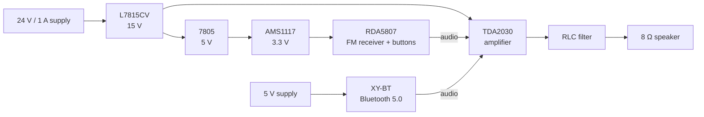

# Radio – FM Radio with Bluetooth Playback

A hand-built stereo radio featuring an **RDA5807** FM receiver, an **XY-BT 5.0** Bluetooth module and a **TDA2030** amplifier. The device is housed in a modified enclosure and drives an 8 Ω speaker. The radio can be switched off with a button, allowing you to switch to Bluetooth playback of your own music.

---

## Table of Contents

- [Features](#features)
- [Block Diagram](#block-diagram)
- [Components Used](#components-used)
- [Power Supply](#power-supply)
- [Audio Path](#audio-path)
- [Controls](#controls)
- [Enclosure and Cooling](#enclosure-and-cooling)
- [Technical Specifications](#technical-specifications)

---

## Features

-  FM radio reception (RDA5807)
-  Bluetooth 5.0 playback from a smartphone or computer (XY-BT, USB-C)
-  TDA2030 amplifier with an RLC output filter for an 8 Ω speaker
-  Two independent power supplies (5 V and 24 V / 1 A)
-  Buttons on the RDA5807 board to switch off the radio and switch to Bluetooth
-  Custom-designed power section and amplifier on a universal perfboard
-  Heatsinks on all integrated circuits and ventilation slots in the enclosure

---

## Block Diagram



---

## Components Used

| Component | Function |
|---|---|
| 24 V / 1 A power supply | Main power for the universal board |
| 5 V power supply | Separate power for the Bluetooth module |
| L7815CV | 15 V regulator |
| 7805 | 5 V regulator |
| AMS1117 (3.3 V) | 3.3 V regulator |
| RDA5807 | FM radio receiver |
| Bluetooth Audio Module 5.0 Stereo XY-BT (USB-C, MP3) | Bluetooth audio receiver |
| TDA2030 | Audio amplifier |
| RLC filter | Amplifier output filter |
| 8 Ω speaker | Audio output |
| Enclosure | Ready-made box modified to fit |

---

## Power Supply

The device uses **two independent power supplies**.

### 5 V supply – Bluetooth module
The 5 V supply powers the **XY-BT** Bluetooth module directly.

### 24 V / 1 A supply 
The 24 V is gradually stepped down on the universal board by a cascade of regulators:

```
24 V ──► L7815CV ──► 15 V ──┬──► TDA2030 (amplifier)
                            │
                            └──► 7805 ──► 5 V ──► AMS1117 ──► 3.3 V ──► RDA5807
```

| Branch | Regulator | Input | Output | Powers |
|---|---|---|---|---|
| 15 V | L7815CV | 24 V | 15 V | TDA2030 amplifier, 7805 regulator |
| 5 V | 7805 | 15 V | 5 V | AMS1117 regulator |
| 3.3 V | AMS1117 | 5 V | 3.3 V | RDA5807 FM receiver |

---

## Audio Path

1. The **RDA5807** provides the audio signal from FM broadcasts.
2. The **XY-BT Bluetooth module** provides the audio signal from the connected device.
3. Both sources are connected to the **input of the TDA2030 amplifier**.
4. The **TDA2030** amplifies the signal.
5. The amplified signal passes through the **RLC filter** on the universal board.
6. The output is connected to the **8 Ω speaker**.

---

## Controls

The board with the RDA5807 module has buttons for controlling the radio.

- **Radio:** the RDA5807 plays FM broadcasts.
- **Bluetooth:** the radio is switched off with a button, after which you can connect to the Bluetooth module and play your own music.

---

## Enclosure and Cooling

The device is housed in a **ready-made box bought in a store**, which I modified myself:

- the box was cut to the required dimensions,
- the speaker opening was milled out,
- there are ventilation slots inside for airflow.

All integrated circuits (L7815CV, 7805, AMS1117, TDA2030) have **heatsinks**. During operation the device **does not heat up**, despite the regulator cascade.

---

## Technical Specifications

| Parameter | Value |
|---|---|
| Main power supply | 24 V / 1 A |
| Bluetooth module supply | 5 V |
| Amplifier voltage | 15 V |
| FM receiver voltage | 3.3 V |
| Amplifier | TDA2030 |
| Speaker impedance | 8 Ω |
| FM receiver | RDA5807 |
| Bluetooth | 5.0, stereo, USB-C |
| Output filter | RLC |
