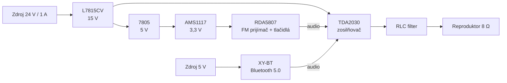

[English version](README.en.md)

# DIY-Radio-RDA5807# Radio – FM rádio s Bluetooth prehrávaním

Vlastnoručne postavené stereo rádio s FM prijímačom **RDA5807**, Bluetooth modulom **XY-BT 5.0** a zosilňovačom **TDA2030**. Zariadenie je zabudované v upravenej krabici a poháňa reproduktor s impedanciou 8 Ω. Rádio je možné tlačidlami vypnúť a prepnúť na Bluetooth prehrávanie vlastnej hudby.

---

## Obsah

- [Funkcie](#funkcie)
- [Blokové schéma](#blokové-schéma)
- [Použité komponenty](#použité-komponenty)
- [Napájanie](#napájanie)
- [Audio cesta](#audio-cesta)
- [Ovládanie](#ovládanie)
- [Skrinka a chladenie](#skrinka-a-chladenie)
- [Technické parametre](#technické-parametre)

---

## Funkcie

-  Príjem FM rozhlasového vysielania (RDA5807)
-  Bluetooth 5.0 prehrávanie zo smartfónu alebo počítača (XY-BT, USB-C)
-  Zosilňovač TDA2030 s výstupným RLC filtrom pre reproduktor 8 Ω
-  Dva nezávislé zdroje napájania (5 V a 24 V / 1 A)
-  Tlačidlá na doske s RDA5807 na vypnutie rádia a prepnutie na Bluetooth
-  Vlastný návrh napájacej časti a zosilňovača na univerzálnej doske plošných spojov
-  Chladiče na všetkých integrovaných obvodoch a vetracie štrbiny v skrinke

---

## Blokové schéma



---

## Použité komponenty

| Komponent | Funkcia |
|---|---|
| Sieťový zdroj 24 V / 1 A | Hlavné napájanie univerzálnej dosky |
| Zdroj 5 V | Samostatné napájanie Bluetooth modulu |
| L7815CV | Stabilizátor 15 V |
| 7805 | Stabilizátor 5 V |
| AMS1117 (3,3 V) | Stabilizátor 3,3 V |
| RDA5807 | FM rádio prijímač |
| Bluetooth Audio Module 5.0 Stereo XY-BT (USB-C, MP3) | Bluetooth audio prijímač |
| TDA2030 | Audio zosilňovač |
| RLC filter | Výstupný filter zosilňovača |
| Reproduktor 8 Ω | Zvukový výstup |
| Skrinka | Hotová krabica upravená na mieru |

---

## Napájanie

Zariadenie používa **dva nezávislé zdroje**.

### Zdroj 5 V – Bluetooth modul
Zdroj 5 V napája priamo Bluetooth modul **XY-BT**.

### Zdroj 24 V / 1 A 
Napätie 24 V sa na univerzálnej doske postupne upravuje kaskádou stabilizátorov:

```
24 V ──► L7815CV ──► 15 V ──┬──► TDA2030 (zosilňovač)
                            │
                            └──► 7805 ──► 5 V ──► AMS1117 ──► 3,3 V ──► RDA5807
```

| Vetva | Stabilizátor | Vstup | Výstup | Napája |
|---|---|---|---|---|
| 15 V | L7815CV | 24 V | 15 V | zosilňovač TDA2030, stabilizátor 7805 |
| 5 V | 7805 | 15 V | 5 V | stabilizátor AMS1117 |
| 3,3 V | AMS1117 | 5 V | 3,3 V | FM prijímač RDA5807 |

---

## Audio cesta

1. **RDA5807** poskytuje audio signál z FM vysielania.
2. **Bluetooth modul XY-BT** poskytuje audio signál z pripojeného zariadenia.
3. Oba zdroje sú pripojené na **vstup zosilňovača TDA2030**.
4. **TDA2030** signál zosilní.
5. Zosilnený signál prechádza cez **RLC filter** na univerzálnej doske.
6. Výstup je pripojený na **reproduktor 8 Ω**.

---

## Ovládanie

Na doske s modulom RDA5807 sú tlačidlá na ovládanie rádia.

- **Rádio:** RDA5807 prehráva FM vysielanie.
- **Bluetooth:** rádio sa vypne tlačidlom, následne sa je možné pripojiť k Bluetooth modulu a prehrávať vlastnú hudbu.

---

## Skrinka a chladenie

Zariadenie je zabudované v **hotovej krabici zakúpenej v obchode**, ktorú som upravil vlastnoručne:

- krabica bola narezaná na potrebné rozmery,
- otvor na reproduktor je vyfrézovaný,
- vo vnútri sú vetracie štrbiny pre prietok vzduchu.

Všetky integrované obvody (L7815CV, 7805, AMS1117, TDA2030) majú **chladiče**. Pri prevádzke sa zariadenie **nezahrieva**, aj napriek kaskáde stabilizátorov.

---

## Technické parametre

| Parameter | Hodnota |
|---|---|
| Hlavné napájanie | 24 V / 1 A |
| Napájanie Bluetooth modulu | 5 V |
| Napätie zosilňovača | 15 V |
| Napätie FM prijímača | 3,3 V |
| Zosilňovač | TDA2030 |
| Impedancia reproduktora | 8 Ω |
| FM prijímač | RDA5807 |
| Bluetooth | 5.0, stereo, USB-C |
| Výstupný filter | RLC |
